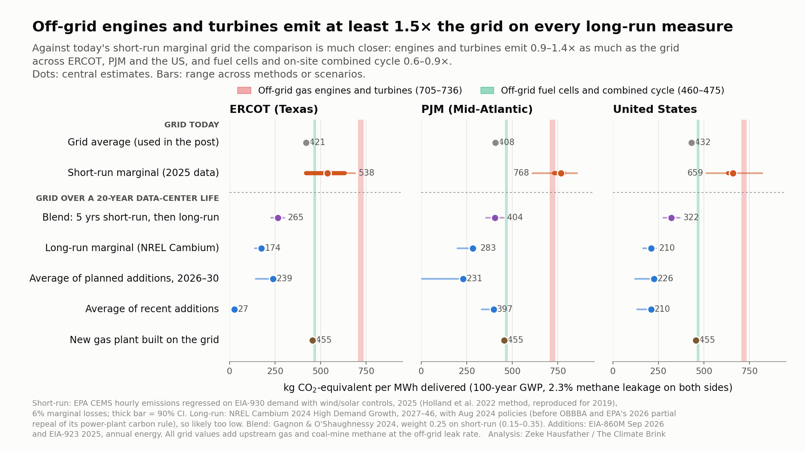

# Does counting marginal grid emissions change the off-grid gas comparison?

On today's grid the gap mostly closes, but over the life of a data center off-grid gas engines and turbines still emit at least 1.5 times as much as the grid.

In my [recent post](https://www.theclimatebrink.com/) I compared the emissions from off-grid gas power at data centers to average grid emissions in ERCOT, PJM and the US as a whole. A number of folks pointed out that a new data center doesn't consume the average MWh on the grid. It consumes the marginal one, and on most US grids the plants that ramp up to meet new demand today are fossil gas and coal. That is a fair critique, so I reran the analysis using a number of different ways of measuring marginal emissions.

The figure below shows the results. The shaded bands are the off-grid options from the original post (engines and turbines at 705 to 736 kg CO2e per MWh, fuel cells and on-site combined cycle at 460 to 475). The dots show the grid counted seven different ways, with methane leaks and coal-mine methane included on the grid side at the same rate as for the off-grid gas.

### Short-run marginal emissions

The short-run marginal rate asks what happens on today's grid, with today's power plants, when demand goes up by one MWh. I estimated it the way [Holland et al. (2022)](https://doi.org/10.1073/pnas.2116632119) did, regressing hourly power plant emissions from EPA's [CEMS](https://campd.epa.gov/data) data on hourly demand from [EIA-930](https://www.eia.gov/electricity/gridmonitor/) for 2025.[^1] This approach reproduces their published 2019 values for Texas and the Eastern US to within 3%.

Here the critics have a point. The short-run marginal grid comes out at 538 kg per MWh in ERCOT, 768 in PJM and 659 for the US, well above the averages I used (408 to 432). Against that benchmark, off-grid engines and turbines emit between 0.9 and 1.4 times as much as the grid (roughly level in PJM and the US, higher in ERCOT). Fuel cells and on-site combined cycle come out at 0.6 to 0.9 times, so on today's margin they are cleaner than the grid in PJM and nationally.[^2]

### Long-run marginal emissions

A data center runs for 20 years or more, and a load this large changes what gets built. Long-run marginal rates try to capture both how the grid is operated and how it grows in response to new demand. NREL's own guidance ([Gagnon and O'Shaughnessy 2024](https://www.nrel.gov/docs/fy25osti/91580.pdf)) is that long-run or blended rates are generally more appropriate for long-lived new loads.[^3]

I tested five versions of this:

| Long-run measure | ERCOT | PJM | US |
|---|---|---|---|
| Blend (five years at the short-run rate, then long-run) | 265 | 404 | 322 |
| NREL [Cambium 2024](https://data.nlr.gov/submissions/289) long-run marginal rate | 174 | 283 | 210 |
| Average of planned additions, 2026-30 ([EIA-860M](https://www.eia.gov/electricity/data/eia860m/)) | 239 | 231 | 226 |
| Average of recent additions | 27 | 397 | 210 |
| A new gas combined-cycle plant built on the grid | 455 | 455 | 455 |

The last row is the most pessimistic case for the grid, where a utility builds a new gas plant to serve the load (as [Entergy is doing](https://www.entergy.com/news/entergy-louisiana-receives-lpsc-approval-for-major-infrastructure-investments-to-support-metas-data-center-and-improve-reliability) for Meta's Louisiana data center, with three combined-cycle plants alongside new solar). On every one of these measures, off-grid engines and turbines emit at least 1.5 times as much as the grid. Cambium's long-run rates are likely too low, as they assume IRA tax credits continue and include EPA power plant rules that have since been [partially repealed](https://www.federalregister.gov/documents/2026/09/17/2026-19071/partial-repeal-of-the-carbon-pollution-standards-for-fossil-fuel-fired-electric-generating-units). But the gap is large enough that even all-gas new build on the grid comes out well ahead.

### So what are the takeaways here?

The case for the grid depends on the time horizon. If the realistic alternative to off-grid gas for the next few years is an existing grid that can't build fast enough, the short-run comparison is the right one, and in that case off-grid engines and turbines are roughly as dirty as the grid while fuel cells come out ahead. For crediting purposes, the UN's CDM grid emission factor tool appears to count only the operating margin (essentially the short-run rate) for projects that add new demand.[^4]

Over the life of a data center, however, the grid will add new generation, and the generators planned for 2026 to 2030 average around 230 kg per MWh, about a third of what off-grid engines and turbines emit. Off-grid fuel cells and efficient combined-cycle plants are a closer call, roughly level with a new gas plant on the grid. Engines and turbines are not, and they make up around 80% of the planned off-grid capacity with identified equipment in Cleanview's 2026 behind-the-meter report.

In case its helpful, all the code, data and methods for this analysis are in this repository (see [METHODS.md](METHODS.md), and [PLAN_marginal.md](PLAN_marginal.md) for the pre-registered plan, the reviews, and every deviation from it).

[^1]: Specifically, I regress each region's hourly CEMS emissions on demand with month and hour-of-day fixed effects and controls for wind and solar output, and add upstream methane, coal-mine methane and 6% marginal transmission losses. PJM uses PJM's own power plants. The US value is a load-weighted average of the three interconnections. The bars in the figure show the range across alternative specifications that pass basic plausibility checks, and a fossil-only variant lands within 9% of EPA's [AVERT](https://www.epa.gov/avert) model. My pre-registered specification (without wind and solar controls) gave implausible results in ERCOT and PJM, and the change is documented in PLAN_marginal.md.

[^2]: The ERCOT result is sensitive to how batteries are treated. Hourly regressions count battery discharge as zero-emission, but the energy has to be stored at some other hour. Using daily totals, which nets this out, gives 663 kg per MWh in ERCOT, at which point off-grid engines and turbines are roughly level with the grid there too.

[^3]: The NREL report was funded by Amazon. Its worked example puts 15% of the weight on the short-run rate for a load with a three-year lag before the grid responds. I use 25% (a five-year lag), with a range of 15% to 35%.

[^4]: This is based on a [Verra draft methodology](https://verra.org/documents/m0325-electricity-system-emission-factor/) (October 2024) that replaces parts of the CDM tool. I was not able to check the UNFCCC text directly. It is a convention for issuing carbon credits rather than an estimate of the consequences of new demand.
