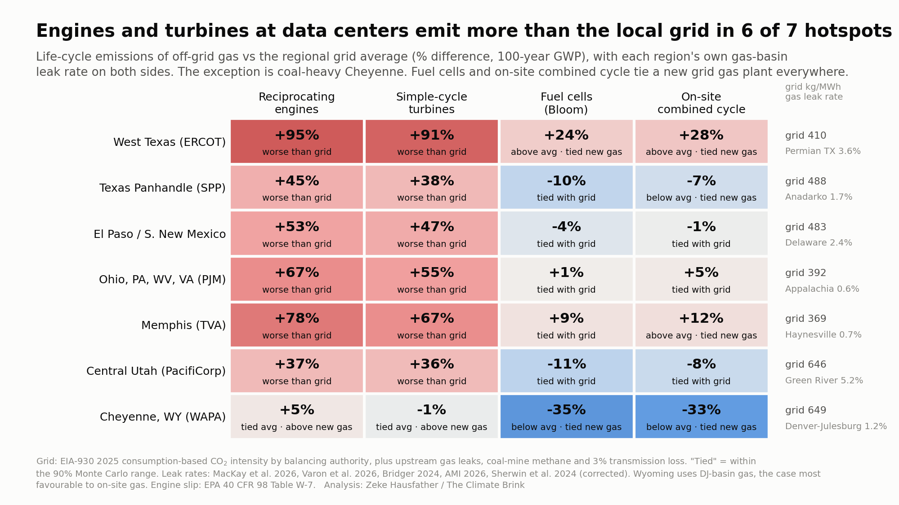

# Off-grid gas for data centers vs the grid, with methane

Code and data for a [Climate Brink](https://www.theclimatebrink.com/) analysis of how off-grid ("behind-the-meter") gas power for data centers compares with grid power, per MWh delivered, once upstream methane leaks and engine methane slip are counted.


## Main results (100-year GWP, 2.3% upstream methane leakage on both sides)
- Reciprocating engines (about 736 kg CO2e/MWh) and simple-cycle turbines (about 705) emit 63–80% more than the 2023 ERCOT, PJM and US grid averages (408–432). They are already 31–63% higher on CO2 alone, because they burn more gas per MWh. Methane (upstream leaks plus engine slip) adds 70–190 kg/MWh to the gap.
- Fuel cells (Bloom) and on-site combined cycle come in 7–17% above the grid averages and level with a new grid combined-cycle plant (455).
- Planned technology mix: of the ~27 GW of planned off-grid data-center capacity with identified equipment in [Cleanview's tracker](https://cleanview.co/reports/behind-the-meter-data-centers/full-report), roughly 46% is simple-cycle turbines, 34% reciprocating engines and 14% fuel cells, with almost no combined cycle. Cleanview reports shares by manufacturer, and the split into technologies is ours (`data/cleanview_shares.json`, METHODS).
- Engine slip: the central case uses EPA's 40 CFR 98 Table W-7 factor (about 2.8% of methane in). Even at 12% fleet-average slip, the upper end Frost Methane's Olya Irzak cited for part-load operation, engines reach about 1,170 kg/MWh, 2.7–2.9 times the grid averages (`results/slip_sensitivity.csv`).
- Frost Methane's fleet estimate (380 Mt CO2e over 18 months for 50 GW) is reproduced to four figures by a mass balance in which 7.5% of produced methane escapes (`scripts/v2_frost.py`). That is above the 5–6% total loss implied here, and the 18-month total assumes all 50 GW running from day one.

## Regional results
For seven data-center hotspots, each region uses its 2025 EIA-930 consumption-based grid intensity and the measured leak rate of its likely supply basin on both sides.



- Engines and turbines emit 36–95% more than the local grid in six of seven regions.
- The exception is coal-heavy Cheyenne, WY. There they are level with the grid average but 55–64% above a new grid gas plant.
- Central Utah's "worse" result depends on a low-confidence Green River leak rate (5.2%).
- Fuel cells and on-site combined cycle tie a new grid gas plant everywhere.

How much each region's result moves across its basin's measured leak range is shown in `figures/regional_basin_ranges.png`.

## Supplementary
- A 20-year GWP view and FaIR 2.2.2 fleet warming runs (`results/fair_fleet.json`). FaIR's calibrated ensemble weights methane more heavily than AR6 metrics.
- Monte Carlo tie bands, break-even leak rates and sensitivity tests (`results/`).
- A small rich-burn genset case, kept in the tables but not drawn because it covers one project.

## Process
- `PLAN.md` and `PLAN_regional.md` are pre-analysis plans, frozen before results. They were reviewed by a domain reviewer and a methods reviewer (`reviews/`), and each has a change log of post-freeze deviations.
- `METHODS.md` documents every parameter, validation check, sensitivity and caveat.
- Validation checks:
  - V1 reproduces NETL's 2025 combined-cycle life-cycle intensity to −0.9%.
  - V2 reproduces Frost's fleet numbers.
  - V3 compares FaIR's methane metrics with AR6.

## Pipeline
```bash
cd scripts
python3.13 v1_netl_check.py      # validation: reproduce NETL Rev1 NGCC (-0.9%)
python3.13 grid.py               # eGRID2023 + Cambium 2024 -> data/grid_inputs.json (needs the two xlsx files)
python3.13 v2_frost.py           # Frost Methane fleet-number consistency
python3.13 cases.py              # case table, primary test, break-even leak rates, Monte Carlo, sensitivities
python3.13 v3_fair_metrics.py    # FaIR pulse check vs AR6 metrics
python3.13 fair_fleet.py         # FaIR fleet-scale runs (~5 min)
python3.13 make_figure.py        # figures/offgrid_gas_vs_grid.png
python3.13 slip_sensitivity.py   # recip slip at 2.8% (W-7) / 4 / 6 / 12% -> results/slip_sensitivity.csv

# regional sensitivity (PLAN_regional.md)
python3.13 eia930_intensity.py   # streams EIA-930 per-BA workbooks -> data/eia930_intensity.json (~10 min, deletes raw)
python3.13 regional.py           # hotspot regions x basin leak rates, per-region MC, four-state classification
python3.13 make_regional_figures.py   # figures/regional_heatmap.png, figures/regional_basin_ranges.png
python3.13 write_regional_methods.py  # regenerates the regional section of METHODS.md
```
Requirements: Python 3.13, numpy, pandas, scipy, matplotlib, openpyxl, and fair==2.2.2.

`data/grid_inputs.json` is committed, so `cases.py` and the figure run without the raw workbooks. To rebuild from scratch, download these into `data/`:
- `egrid/egrid2023_data_rev2.xlsx` from https://www.epa.gov/egrid/download-data
- `cambium/Cambium24_Workbook.xlsx` from https://data.nlr.gov/submissions/289
- `fair_calib/calibrated_constrained_parameters.csv` from Zenodo record 17424050 (the other calibration CSVs are committed)

## Data sources and licenses
| Source | Terms |
|---|---|
| EPA eGRID, EPA AP-42, 40 CFR 98 | US government works, public domain |
| NREL/NLR Cambium 2024 | public |
| FaIR calibration data (Smith et al., Zenodo 17424050) | cite Smith et al. 2024, GMD 17, 8569 |
| NETL Rev1 (DOE/NETL-2025/4933) | public |
| EIA-930 hourly grid data, EIA coal tables | US government works, public domain |
| Basin leak rates (MacKay et al. 2026, Varon et al. 2026, Sherwin et al. 2024, others) | values cited in `data/basin_leak_rates.json`; papers not redistributed |
| Cleanview behind-the-meter tracker | manufacturer shares cited in `data/cleanview_shares.json`; page not redistributed |

Vendor data sheets (Caterpillar, GE Vernova, Solar Turbines, Bloom, Generac, Wärtsilä, INNIO), papers and web pages are cited, not redistributed. `sources/` holds our research notes (`FINDINGS.md`, `FINDINGS2.md`, `BASINS.md`), with quotes and URLs for every value used. The plans, reviews and notes sometimes cite local copies of pages under `sources/`. Those copies are not in this repository; use the URLs given alongside them.

Code: MIT license.
