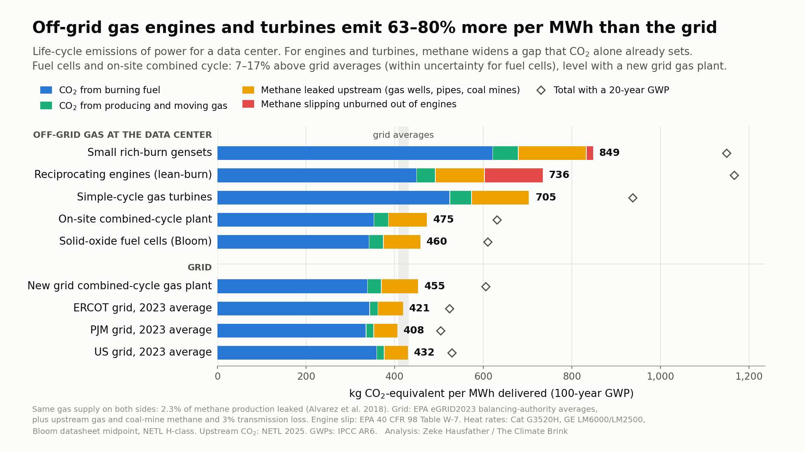

# Off-grid gas for data centers vs the grid, with methane

How do behind-the-meter (BTM) gas plants for data centers compare with grid power, per MWh delivered, once engine methane slip and
upstream leakage count? Does methane change the ranking, or only the size of the gap?

**Answer (GWP100, 2.3% methane leakage on both sides):**
- Reciprocating engines and simple-cycle turbines emit 63–80% more than the ERCOT, PJM and US grid averages. They are already 31–63% higher on CO2 alone, so methane widens the gap without creating it.
- Fuel cells and on-site combined cycle come in 7–17% above the grid averages and level with a new grid combined-cycle plant.
- Methane changes no verdict under the pre-registered test.

See `METHODS.md` for the full results and caveats and `PLAN.md` for the frozen pre-analysis plan and its change log.



## Pipeline
```bash
cd scripts
python3.13 v1_netl_check.py      # validation: reproduce NETL Rev1 NGCC (-0.9%)
python3.13 grid.py               # eGRID2023 + Cambium 2024 -> data/grid_inputs.json (needs the two xlsx files)
python3.13 v2_frost.py           # Frost Methane fleet-number consistency
python3.13 cases.py              # case table, primary test, break-even leak rates, Monte Carlo, sensitivities
python3.13 v3_fair_metrics.py    # FaIR pulse check vs AR6 metrics
python3.13 fair_fleet.py         # FaIR fleet-scale runs (~5 min)
python3.13 make_figure.py        # figures/offgrid_gas_vs_grid.png
```
Requirements: Python 3.13, numpy, pandas, scipy, matplotlib, openpyxl, and fair==2.2.2.

`data/grid_inputs.json` is committed, so `cases.py` and the figure run without the raw workbooks. To rebuild from scratch, download these into `data/`:
- `egrid/egrid2023_data_rev2.xlsx` from https://www.epa.gov/egrid/download-data
- `cambium/Cambium24_Workbook.xlsx` from https://data.nlr.gov/submissions/289
- `fair_calib/calibrated_constrained_parameters.csv` from Zenodo record 17424050 (the other calibration CSVs are committed)

## Data sources and licenses
| Source | Terms |
|---|---|
| EPA eGRID, EPA AP-42, 40 CFR 98 | US government works, public domain |
| NREL/NLR Cambium 2024 | public |
| FaIR calibration data (Smith et al., Zenodo 17424050) | cite Smith et al. 2024, GMD 17, 8569 |
| NETL Rev1 (DOE/NETL-2025/4933) | public |

Vendor data sheets (Caterpillar, GE Vernova, Bloom, Generac, Wärtsilä, INNIO) are cited, not redistributed. `sources/` holds notes and the pages we read.

Code: MIT license.
